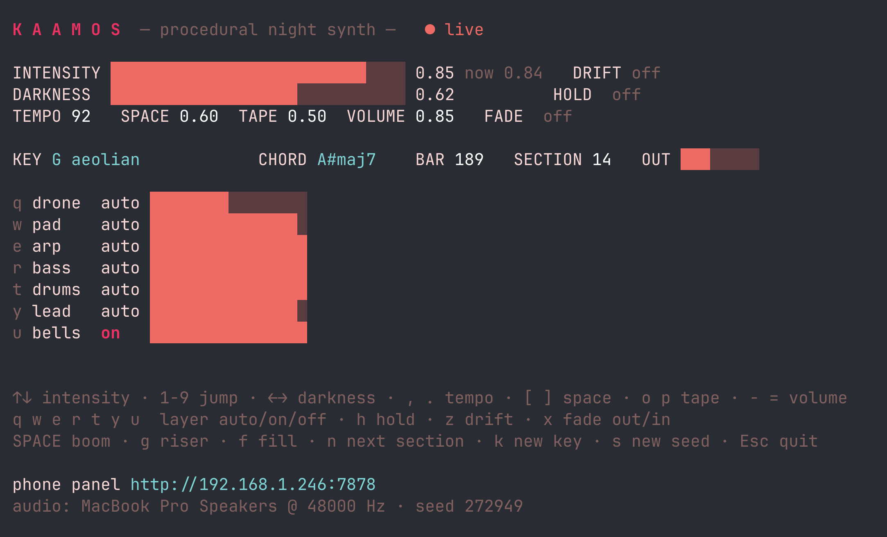
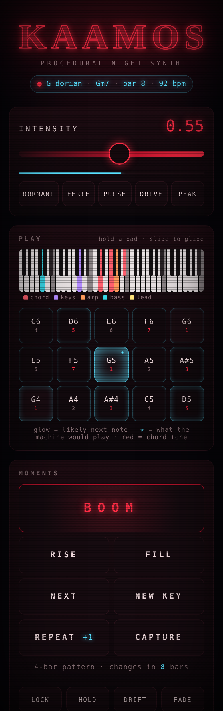

# KAAMOS

*Kaamos* is the Finnish polar night, the weeks when the sun never rises.
This is a procedural 80s night-synth machine for it: arpeggiated analog synths, Juno pads,
an ominous low drone, a DX-style electric piano, gated-reverb drums, FM bells and a wobbly
VHS tape stage.
All of it is synthesized in Rust, live, forever. No samples, no plugins.



## Why

I've played keyboards since I was five, but I've never been able to write proper songs.
C64, the demoscene, Scream Tracker, FastTracker, and last year finally learning Reaper properly.

I was kind of vibing all the time and sounded like Ross Geller. So I replicated my way of
working (randomness with highs and lows, with harmonies) and generated this for you.

## What it does

One knob matters most: **intensity**. At 0 it's a dark pad and a drone breathing in the
snow. At 1 it's a full pulsing synth score with drums, sequenced bass and a lead.
Everything in between fades in and out smoothly, so you can ride it during a talk.

The music never repeats on its own: modes, chord progressions, arpeggio motifs, bass lines,
melodies, fills and key changes are generated as it plays. When you hear something you
like, you can keep it (repeat or lock the pattern) and capture it as
[Strudel](https://strudel.cc/) code.

## Run

```sh
cargo run --release
```

macOS needs nothing extra. On Linux (incl. Steam Deck) you need the ALSA headers:
`sudo apt install libasound2-dev pkg-config` (or `pacman -S alsa-lib`).

It starts quietly at intensity 0.3, fades in, and prints a link like
`http://192.168.1.23:7878`. Open it on your phone (same Wi-Fi) for the stage panel.



## Controls

| Key | Action |
|---|---|
| `↑` `↓` | intensity ± 0.05 |
| `1` … `9` | jump intensity: 1 = dormant … 5 = pulse … 9 = peak (it glides, never jumps) |
| `←` `→` | darkness (bright nostalgic modes ↔ dark/phrygian) |
| `,` `.` | tempo ± 2 BPM |
| `[` `]` | space (reverb) |
| `o` `p` | tape / VHS wear |
| `-` `=` | volume |
| `q w e r t y u i` | layers drone / pad / arp / bass / drums / lead / bells / keys: cycle **auto → on → off** |
| `SPACE` | **BOOM**: sub drop + crash, for slide reveals (instant) |
| `g` | riser that lands on a bar line |
| `f` | drum fill on the next bar |
| `n` | new section (new progression, arp motif, melody) on the next bar |
| `k` | modulate to a new key |
| `l` | repeat the current pattern one more round (press 3× = 3 extra rounds) |
| `L` | lock the pattern: it repeats until you press `L` again (`n` still jumps on) |
| `c` | capture the current pattern as Strudel code |
| `m` | play a whole song (the free music fades out, the song starts on a bar line); `m` again stops it |
| `h` | hold: freeze on the current chord |
| `z` | drift: the machine wanders between calm and intense by itself |
| `x` | fade out (10 s) / fade back in |
| `Esc` / `Q` | quit (with a short fade) |

Intensity stays live while a pattern repeats or is locked: the same chords, motif and
melody keep going while layers, drums and filters follow the knob. Lock a pattern and push
the intensity up for a build.

The phone panel has the same controls plus big preset buttons
(DORMANT · EERIE · PULSE · DRIVE · PEAK), REPEAT, LOCK, CAPTURE and the drift range.

## Whole songs

The same generator can also write a complete track, 2 to 4 minutes long:

```sh
kaamos song                     # a new song, saved as kaamos-song-<seed>.wav
kaamos song --seed 8 --strudel  # the same song every time, plus Strudel code for it
```

It prints the plan before rendering:

```
KAAMOS song · seed 8 · E dorian · 96 bpm · 3:30 · back-to-the-intro ending
   0:00  intro           8 bars  Em G A D               radio: interval signal (6 notes of the chorus hook)
   0:20  verse 1         8 bars  Em D A Em              opens with the lead
   0:40  pre-chorus      4 bars  F#m D                  2-bar riser
   0:50  chorus 1        8 bars  Em G A D
   1:10  verse 2         8 bars  Em D A Em
   1:30  pre-chorus 2    4 bars  F#m D                  2-bar riser
   1:40  chorus 2        8 bars  Em G A D
   2:00  B-section       8 bars  G A                    radio static
   2:20  build           4 bars  G A                    4-bar riser
   2:30  climax         16 bars  Em G A D               BOOM
   3:10  outro           8 bars  Em G A D               radio static, fade out
```

- **Intro**: pad and drone, or an arpeggio on its own. Sometimes a **radio** comes in:
  static and a tuning whistle, then morse code, a numbers-station interval signal that
  plays the start of the chorus melody, or your own voice clips.
- **Verse** opens with the **bass** (with a heartbeat kick) or with the **lead**, and the
  rest of the band joins.
- **Pre-chorus**: two chords that want to go somewhere, a riser and a snare build.
- **Chorus**: its own progression (usually starting away from the home chord) and a
  hook written to be remembered: higher, rhythmic, repeating. It is the same every time
  it comes back.
- **B-section**: a breakdown on new chords with keys and bells, then a four-bar build.
- **Climax**: the chorus again with BOOM, four-on-the-floor drums and often a key change
  up a step or a half step.
- **Ending**: a fade-out, a hard stop on the home chord, or a return to the intro mood.

The seed picks the key, mode, tempo, form, opening and ending. `--minutes 2.5`,
`--bpm`, `--darkness`, `--ending fade|stop|bookend` and `--radio on|off` steer it.
Measured in LUFS, the sections follow the shape you'd expect: verse below chorus,
the B-section drops about 3-4 dB, the climax is the loudest part.

### Radio voices

Any WAV clips (any sample rate, mono or stereo) become a crackly radio dialogue in the
intro. They alternate between two radio colours, so two clips sound like two people:

```sh
kaamos song --voice base.wav --voice pilot.wav
kaamos --voice base.wav --voice pilot.wav     # live: used when you press m
```

### Songs live

Press `m` (or PLAY A SONG on the phone) and the machine plays a whole song, then fades
back into free mode. During the song, `n` skips to the next part, `L` holds the current
part until you release it, `l` repeats it once more, and the intensity knob still works
inside a part. `--song` starts the session straight into a song.

## Play along

Both the terminal and the phone show a five-octave keyboard where the sounding notes
light up: chord red, keys violet, arpeggio orange, bass cyan, lead yellow. Keys that are
in the current key are brighter, so on a real keyboard you can see which notes are safe.

The phone's **PLAY** pads are the scale (two octaves, out-of-key notes left out).
Hold a pad to play the lead, slide across pads to glide between notes. While you play,
the machine's own melody steps aside and comes back a few seconds after you stop.

The pads glow with how likely each note is as the **next** note, from a small model of
how melodies move: chord tones are stable, small steps beat leaps, a leap is answered by
a step back the other way, the leading tone rises to the tonic, the 4th falls to the 3rd.
The ★ marks the note the machine itself would play next. The terminal shows the same
suggestions as ▲ marks under the keyboard.

## Keys

A DX-era FM electric piano (warm 1:1 body plus a short 14:1 tine, suitcase tremolo) comps
the chords in the middle intensities. Each section picks a comping pattern: ballad
whole notes, slow rising arpeggio, broken chords, 3+3+2, push, two-and or offbeat stabs.

## Capture to Strudel

Press `c` (or CAPTURE on the phone) and the pattern that is playing is written as code to
`kaamos-<seed>.strudel.js` in the current folder (`--export-dir` to change it):
pad chords, arpeggio, bass line, melody, keys, drums, drone and bells, with the filter and
reverb settings of that moment.

A song rendered with `--strudel` is written to `kaamos-song-<seed>.strudel.js`: one
pattern per section (`intro`, `verse1`, `chorus1`, … `climax`) and an `arrange()` that
plays the whole song with the right bar counts.

Every capture with the same seed is **appended** to the same file as `p1`, `p2`, `p3` …,
and the `arrange(...)` line at the end plays them in order as a song. A new seed starts a
new file. Paste the file into <https://strudel.cc> and press Ctrl+Enter.

Capturing the same pattern at different intensities gives you a quiet and a full
version of it to arrange.

## For a presentation

- Run it on the presenting laptop, control it from the phone: your slides keep focus.
- Turn on **drift** with a range like 0.15 to 0.5 and it scores the whole talk unattended.
- `--seed 1234` gives the same musical material every time (handy for rehearsal).
- `--headless` skips the terminal UI; `--bind 127.0.0.1` keeps the panel local-only.
- Without a network, the panel still works on `http://localhost:7878` on the same machine.

## Offline render (for videos)

```sh
kaamos render score.wav --minutes 4 --seed 7 \
  --curve  "0:0.05, 30:0.25, 1m:0.5, 1m40:0.75, 2m10:1, 3m:0.3" \
  --events "1m58:riser, 2m30:boom, 2m40:lead=off, 3m30:fade"
```

`--curve` automates intensity (`time:value`, times in seconds or `1m30`).
`--events` fires any command at a time: triggers `boom fill riser next key loop export`,
toggles `drift hold lock fade`, layers `arp=off` / `lead=on` / `keys=auto`, params
`darkness=0.9`, `bpm=100`, `space=0.8`, or live lead notes `play=72` / `play=-1`.
The render ends with a fade (`--no-fade` to skip).

## Pipe mode

`kaamos --stdout | ffplay -f s16le -ar 48000 -ac 2 -nodisp -` streams raw PCM instead of
using the sound card (builds without the `audio` feature can only do this and `render`).

## Web API

`GET /api/state` returns JSON, `GET /api/stream` streams it as server-sent events.
`GET /api/cmd?c=<command>` runs the same commands as `--events` (URL-encode `=` as `%3D`),
e.g. `curl "localhost:7878/api/cmd?c=boom"`. `GET /api/play?n=72` plays a lead note,
`n=-1` releases it.
Handy for triggering from Keynote/OBS scripts or a Stream Deck.

## Inside

- `dsp.rs`: polyBLEP oscillators, zero-delay-feedback ladder filter, SVF, envelopes
- `instruments.rs`: Juno pad, resonant arp, sequencer bass, drone + air, glide lead,
  FM bells, FM electric piano, 808/Linn-style drums, boom / crash / riser
- `fx.rs`: ensemble chorus, ping-pong tape echo, 8-line FDN hall, gated reverb, tape
  machine (saturation, wow & flutter, hiss), look-ahead limiter
- `music.rs`: modes ordered bright to dark, diatonic progressions, voice-led voicings,
  arp motifs, bass patterns, phrase-based lead melodies, keys comping patterns and the
  next-note model
- `engine.rs`: the clock, the composer (sections, key changes, fills, repeats) and the mix;
  intensity drives layer gains, filter openness, arp rate, drum patterns and sidechain pump
- `song.rs`: the song planner (parts, form, arrangement, endings)
- `radio.rs`: the radio intro (static, tuning, morse, interval signal, voice clips)
- `wav.rs`: reading WAV voice clips
- `strudel.rs`: pattern and song capture to Strudel code

The only dependency is [cpal](https://github.com/RustAudio/cpal) for sound-card output.
Everything else (DSP, terminal UI, web server) is plain `std`.

## Ideas

- MIDI controller input (mod wheel → intensity).
- Record the live session to WAV.

## License

MIT
